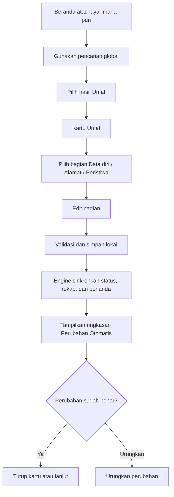
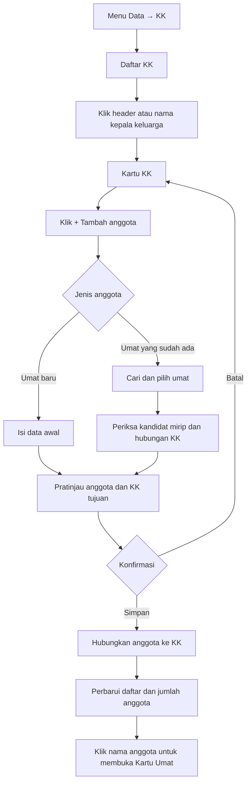

# plan.md — Aplikasi Input & Verifikasi Statistik Umat (1 Lingkungan)

> Versi 1.3 — rancangan UX global (sinkron Git terenkripsi + router LLM Gemini multi-kunci) · Dasar: `Form_Statistik_Umat.xlsx` (17 sheet, tahun statistik 2026)
> Skala: ± 350 umat, ± 130 KK, satu lingkungan, satu pengisi (ketua lingkungan atau yang dimandatkan)

---

## 1. Ringkasan

Aplikasi web yang berjalan **sepenuhnya di laptop** (tanpa server data, tanpa akun, tanpa database cloud). Tugasnya hanya dua: **mendeteksi** apa yang diisi, lalu **menyinkronkannya** ke semua sheet terkait. Hasil akhirnya adalah **file Excel dengan struktur identik dengan template** yang Anda unggah, sehingga cetakan dan penggabungan oleh paroki tidak berubah.

| Keputusan | Pilihan | Alasan |
|---|---|---|
| Penyimpanan data | **IndexedDB di browser laptop** (Dexie) + cadangan file otomatis ke folder pilihan | 350 umat sangat kecil; tidak butuh database server |
| Backend / Neon | **Tidak dipakai** | Sesuai keputusan Anda: data berbasis laptop |
| Hosting | **Vercel (situs statis)** | Hanya menyajikan kode aplikasi. Data tidak pernah dikirim ke Vercel |
| Framework | **React + Vite + TypeScript** | Cepat, mudah dirawat, bisa jadi PWA (jalan offline) |
| Ekspor Excel | **Penambalan langsung XML template (OOXML patching)** | Satu-satunya cara aman agar chart, tabel, format, dan pengaturan cetak tetap persis |
| LLM | **Opsional, default mati**: Gemini dengan beberapa kunci dan beberapa model, *round-robin* + fallback (Fase 6, boleh dipotong) | Aplikasi harus lengkap tanpa LLM |
| Cadangan di luar laptop | **Sinkron ke repo Git privat, terenkripsi di browser** | Bertahan dari laptop rusak/hilang, browser reset, salah hapus. Git hanya melihat data terenkripsi |

---

## 1a. Status Implementasi (living doc — diupdate setiap akhir fase)

> Terakhir diupdate: 17/10/2026

| Fase | Nama | Status | Catatan |
|---|---|---|---|
| 0 | Penguncian spesifikasi & audit template | ✅ Selesai | `schema.json`, `sync-matrix.md`, `decisions.md`, `fixtures/` |
| 1 | Fondasi proyek & mesin logika | ✅ Selesai | Vite + React 19 + TypeScript strict, Dexie DB, engine murni (`src/engine`), 14 uji lulus, build bersih |
| 2 | Mesin ekspor ke template | ✅ Selesai | Patching XML (KUB, A5, rumus Jiwa, cache), lapis a–b otomatis lulus, backtest rumus cocok, uji manual di Excel asli lulus 17/10/2026 |
| 3 | UI inti | ✅ Selesai | Pengaturan, Umat, KK, Peristiwa, Rekap, Ekspor, Cadangan lokal & manual + Pulihkan di `src/ui/screens` + `src/state/store.ts`; sinkron Git terenkripsi (AES-256-GCM, GitHub API) di `src/backup` selesai |
| 4 | Sinkron terlihat, Rekap, penanda | ✅ Selesai | Perubahan Otomatis + Urungkan (`Perubahan.tsx`), Perlu Ditindaklanjuti/Penanda (`Penanda.tsx`), Duplikat (`Duplikat.tsx`), Rekap klik angka → daftar nama → Kartu Umat (`Rekap.tsx`), Home ringkasan (`Home.tsx`), store undo/redo + audit otomatis + keputusan duplikat (`store.ts`), persistence penanda + keputusan (`persistence.ts`), `KeputusanDuplikat.keputusan` → 'gabung' | 'beda-orang' (`types.ts`) |
| 5 | Upload Excel & deteksi kolom | ✅ Selesai | `src/import/parser.ts` (baca xlsx/csv), `src/import/detector.ts` (deteksi header, sinonim, pola isi, tingkat keyakinan, konversi ke Umat), `src/ui/screens/Impor.tsx` (layar konfirmasi pemetaan, pratinjau, mode impor tambah/lengkapi/lewati), rute 'impor' di App.tsx |
| 6 | LLM Gemini (autodetect kolom ambigu) | ✅ Selesai | `src/llm/types.ts`, `client.ts` (REST generateContent), `router.ts` (multi-kunci round-robin, backoff 429, fallback tingkat 3.1-flash-lite → 3.5-flash-lite → 3.6-flash), `store.ts` (Zustand), UI `LLM.tsx` (kunci, toggle, uji, mode hanya struktur), integrasi `Impor.tsx` (deteksiKolomDenganLLM + saran + terapkan), `vite.config.ts` (alias @llm, define kunci dari .env) |
| 7 | Uji lapangan & pengerasan | ✅ Selesai | PWA offline (vite-plugin-pwa, service worker, manifest, ikon SVG), penanganan kegagalan (salinan darurat localStorage + window.onerror), uji kapasitas 2.000 umat (in-memory 19ms, ID tidak bergeser, tidak duplikat), aksesibilitas dasar (kontras, navigasi keyboard), tinjauan teks UI konsisten |
| 8 | Penyelarasan UX, deploy final & serah terima | ⏳ Belum | Menerapkan sistem desain global, App Shell, Kartu Umat/KK, user flow dan verifikasi responsif sebagaimana bagian 4.4–4.13 |

**Build & Dev (status yang tercatat 17/10/2026):** `npm run build` lulus (TypeScript + Vite, 0 error). Vitest 18/18 lulus (14 engine + 4 uji emas ekspor), backtest `scripts/backtest-xlsx.mjs` seluruhnya OK.

> **Catatan revisi UX:** bagian layout, sistem desain, global CSS, komponen, dan user flow di bawah adalah spesifikasi yang diusulkan untuk diterapkan pada front end. Penambahan spesifikasi ini **tidak berarti** perubahan visual tersebut sudah diterapkan atau diuji di kode. Status implementasinya harus diperbarui setelah pekerjaan dan pengujian benar-benar dilakukan.

---

## 2. Prinsip yang dikunci (dari diskusi)

1. **Satu lingkungan saja.** Tidak ada multi-lingkungan, multi-pengguna, atau peran. Nama lingkungan diisi sekali di Pengaturan dan otomatis dipakai di seluruh file.
2. **Tidak ada kolom baru, kecuali KUB**: kolom **AA di DATA UMAT** dan **L di DATA KK**. Struktur kolom dan nilai dropdown hasil ekspor sama dengan template.
3. **Tugas aplikasi = autodetect + sinkron**, bukan otomatisasi penuh. Tidak ada keputusan yang dibuat aplikasi atas nama ketua lingkungan.
4. **Aplikasi tidak menilai alasan.** Apa pun yang diisi di sheet `DITERIMA MASUK` (atau sheet peristiwa lain) dianggap sah. Aplikasi hanya mendeteksi data masuk dan menyinkronkannya.
5. **Tidak ada fitur penetapan Katolik, alasan khusus, maupun daftar periksa dokumen.** Detail dokumen menyusul di versi berikutnya.
6. **Data lisan/tidak lengkap boleh disimpan.** Penanda hanya pengingat, tidak pernah memblokir penyimpanan, tidak pernah mengubah angka rekap, dan tidak dianggap cacat data.
7. **Aktif** = berstatus Katolik, masih tinggal di lingkungan ini, masih hidup. Status dihitung dari peristiwa bertanggal (kematian, mutasi, pindah agama, pindah alamat, diterima masuk).
8. **Tampilan aplikasi boleh berbeda dari Excel** demi kemudahan pengisian. Yang wajib identik adalah **file hasil ekspor**.
9. **Data pribadi tidak keluar dari laptop dalam bentuk terbaca.** Satu-satunya yang keluar adalah (a) cadangan **terenkripsi** ke repo Git privat milik Anda, dan (b) bila Anda sendiri mengaktifkan Fase 6, nilai yang disamarkan ke Gemini API.

### Bahasa antarmuka
Kata **"kejanggalan", "cacat", "error", "salah", "invalid" tidak dipakai** di antarmuka. Hanya dua penanda:

- **Perlu dilengkapi** — ada isian yang belum diketahui/terisi.
- **Perlu konfirmasi** — ada dua data yang saling berselisih atau mirip, mohon dipastikan.

Warna penanda: kuning/biru lembut. Merah hanya untuk kegagalan sistem (misalnya ekspor gagal).

---

## 3. Temuan audit template (fakta dari file Anda)

| Temuan | Konsekuensi pada rancangan |
|---|---|
| 17 sheet; `LIST` tersembunyi berisi nilai dropdown | Nilai dropdown dibaca otomatis dari `LIST`, tidak ditulis ulang manual |
| 13 **Excel Table** (`TblDATAKK` A1:K501, `TblDATAUMAT` A1:Z2001, tabel peristiwa A1:…1001, `TblRekapLingkungan` A4:S104) | Menambah kolom KUB berarti **memperbarui definisi tabel** (ref, jumlah kolom, id kolom baru, autofilter) |
| Gambar/drawing di setiap sheet dan 1 chart di DASHBOARD | Ekspor **tidak boleh** memakai pustaka yang menulis ulang seluruh workbook; harus menambal XML |
| ID di `DATA KK` dan `DATA UMAT` berupa **rumus berbasis nomor baris** (`ROW()-1`) | ID bergantung pada posisi baris. Aplikasi harus menjaga ID tetap (lihat asumsi A4) |
| Kolom Umur (`DATA UMAT` F) dan "umur saat baptis/wafat" (kolom G di `BAPTIS`, `KEMATIAN`) berupa rumus `DATEDIF` | Sel rumus **tidak pernah ditimpa**; aplikasi hanya menulis sel input |
| Sebagian kolom tanggal di `DATA UMAT` bertipe **teks** (`27/10/1991`), sebagian bertipe tanggal sungguhan | Setiap kolom diekspor **sesuai tipe aslinya**, tercatat di `schema.json` |
| Rumus REKAP memakai `COUNTIFS` dengan rentang `DATE(2026,1,1)`–`DATE(2026,12,31)` dan pencocokan teks persis | Nama lingkungan dan nilai dropdown harus seragam; tahun statistik terkunci 2026 |
| Rumus **Jiwa** di `REKAP LINGKUNGAN` saat ini menghitung semua baris umat di lingkungan itu tanpa menyaring status | Disesuaikan agar hanya menghitung **Status = Aktif** (satu-satunya perubahan rumus, lihat A3) |
| Dropdown di `DATA UMAT` hanya terpasang di sel contoh (`B2`, `H2`) | Aplikasi memberi dropdown/autocomplete di semua baris |
| Baris contoh `DATA UMAT`: kolom ID Umat berisi "KK0001", ID KK kosong | Pengimpor harus tahan terhadap isian yang bergeser |
| Template tidak memiliki `calcChain.xml` | Aman mengubah rumus tanpa risiko berkas rusak |

---

## 4. Arsitektur

### 4.1 Stack

- **React 18 + Vite + TypeScript (strict)**
- **Dexie** (IndexedDB) untuk penyimpanan lokal, dengan versi skema dan migrasi
- **Zustand** untuk state UI; seluruh logika bisnis ada di **paket `engine` murni** (tanpa React) agar mudah diuji
- **react-datasheet-grid** (atau setara) untuk Mode Tabel yang mendukung tempel dari Excel
- **JSZip + parser XML** untuk ekspor; **SheetJS (hanya membaca)** untuk impor Excel/CSV
- **Zod** untuk validasi bentuk data impor
- **Vitest** + **fast-check** (pengujian properti), **Playwright** (uji alur), **LibreOffice headless** (menghitung ulang file ekspor sebagai pembanding)
- **vite-plugin-pwa**: bisa dipasang di laptop dan jalan offline

### 4.2 Penyimpanan di laptop

| Lapisan | Fungsi |
|---|---|
| IndexedDB (Dexie) | Penyimpan kerja utama; simpan otomatis setiap perubahan |
| `navigator.storage.persist()` | Meminta browser tidak menghapus data otomatis |
| **Cadangan otomatis ke folder** (File System Access API, Chrome/Edge) | Setiap perubahan (ditunda beberapa detik) menulis `statistik-umat-<lingkungan>.json`, simpan 10 versi bergulir |
| Cadangan manual | Tombol "Simpan cadangan" (unduh `.json`) bila browser tidak mendukung folder otomatis |
| Pulihkan | Satu tombol "Pulihkan dari cadangan" (`.json`) |
| **Sinkron Git terenkripsi** | Salinan di luar laptop (lihat 4.2a) |
| Pengingat | Banner lembut jika cadangan lokal atau Git terakhir > 7 hari, atau belum dipilih/diatur |

**Browser yang disarankan:** Chrome atau Edge pada laptop yang sama. Firefox/Safari tetap berfungsi, tetapi cadangan otomatis ke folder tidak tersedia.

### 4.2a Sinkron Git (lapis cadangan ketiga)

**Tujuan:** bertahan dari kejadian tak terduga: laptop rusak atau hilang, browser direset, salah hapus, berkas korup. Prinsipnya **3-2-1**: tiga salinan (IndexedDB, folder lokal, Git), dua jenis media, satu di luar laptop.

| Aspek | Rancangan |
|---|---|
| **Repo** | Repo **terpisah dan privat** khusus data, mis. `statistik-umat-data-<lingkungan>`. Repo kode tidak pernah berisi data (`.gitignore` dan pemeriksaan CI) |
| **Enkripsi** | Snapshot JSON dikompres lalu dienkripsi **AES-256-GCM di browser** (WebCrypto). Kunci diturunkan dari *kata sandi cadangan* (PBKDF2-SHA256 dengan iterasi tinggi dan salt acak). Git hanya melihat `backup.enc.json`. Repo privat saja tidak cukup karena data memuat nama, tanggal lahir, alamat, dan data keagamaan; akses admin, token bocor, atau repo tak sengaja dipublikkan tidak boleh membuka isinya |
| **Kata sandi cadangan** | Tidak disimpan di mana pun. Bila hilang, cadangan tidak bisa dibuka. Ditegaskan saat pengaturan; disarankan dicatat di tempat aman oleh ketua lingkungan dan satu pengganti |
| **Akses** | *Fine-grained token* GitHub yang dibatasi ke satu repo data, izin **Contents (baca/tulis)** saja, masa berlaku terbatas. Disimpan lokal terenkripsi dengan kata sandi cadangan dan hanya dikirim ke `api.github.com` |
| **Pengaman repo** | Sebelum sinkron, aplikasi memeriksa bahwa repo benar-benar **privat**; bila publik, sinkron ditolak |
| **Kapan commit** | Pada *titik simpan*, bukan tiap ketikan: ≥ 10 menit sejak commit terakhir bila ada perubahan, setelah ekspor, dan tombol **Sinkron sekarang**. Pesan commit netral tanpa nama, mis. `Cadangan 2026-10-16 14:32 · rev 128 · 352 umat` |
| **Penulis tunggal** | Sebelum menulis, aplikasi memeriksa revisi di remote. Bila remote lebih baru dari basis lokal (mis. dari laptop lain), aplikasi **tidak menimpa** dan menawarkan: *Pulihkan dari Git* · *Timpa dengan data laptop ini* · *Simpan sebagai cabang cadangan* |
| **Offline** | Perubahan antre dan terkirim saat online. Indikator "Terakhir tersinkron ke Git: …" selalu terlihat di Beranda |
| **Pulihkan** | Daftar versi dari riwayat commit (tanggal, rev, jumlah umat/KK) → kata sandi → pratinjau ringkasan → pulihkan. Data saat ini otomatis disimpan sebagai cadangan lokal lebih dulu |
| **Ukuran** | Snapshot terkompres hanya puluhan KB, sehingga ribuan commit tetap kecil dan tidak perlu pemangkasan riwayat |

**Mode B (tanpa token di browser):** folder cadangan lokal dijadikan repo Git, dan skrip `sync` (Windows/Mac, disediakan) menjalankan `commit` + `push`, bisa dijadwalkan. Berkas tetap terenkripsi.

Excel tidak perlu ikut di-commit karena selalu bisa dibuat ulang dari data.

### 4.3 Struktur repositori

```
statistik-umat/
├─ public/template/Form_Statistik_Umat.xlsx   # template asli, TIDAK diubah
├─ docs/
│  ├─ schema.json            # hasil audit template (otomatis)
│  ├─ sync-matrix.md         # peta peristiwa → efek di DATA UMAT
│  └─ decisions.md           # log keputusan & asumsi
├─ scripts/audit-template.ts # membaca template → schema.json
├─ src/
│  ├─ engine/                # logika murni (status, sinkron, rekap, penanda, duplikat)
│  ├─ export/                # penambal XML template
│  ├─ import/                # parser + deteksi kolom
│  ├─ db/                    # Dexie, migrasi, cadangan lokal
│  ├─ backup/                # snapshot, enkripsi (WebCrypto), sinkron Git, pulihkan
│  ├─ ui/                    # App Shell, layar, komponen bersama, dan global CSS
│  │  ├─ components/         # komponen UI reusable
│  │  ├─ layouts/            # kerangka halaman utama/detail
│  │  └─ styles/global.css   # token, tipografi, reset, layout, form, tabel, responsif
│  └─ generated/             # tipe TypeScript hasil codegen dari schema.json
├─ fixtures/                 # data uji (kosong, kecil, 350 umat, sampel nyata)
├─ tests/ (unit, property, golden-export, e2e)
└─ vercel.json
```

Tipe data dibuat otomatis dari `schema.json` (codegen), sehingga **kolom di aplikasi tidak mungkin menyimpang dari template**.

### 4.4 Layar dan navigasi utama

Aplikasi memakai satu **kerangka layar global (App Shell)** supaya posisi navigasi, judul, pencarian, status simpan, dan tombol utama konsisten pada semua layar. Nama menu boleh berbeda dari nama sheet Excel; nama sheet hanya dipakai pada Mode Tabel dan proses ekspor.

**Navigasi utama desktop** memakai sidebar tetap di kiri. Pada layar sempit, sidebar berubah menjadi drawer/menu yang dapat dibuka dan ditutup. Susunan menu:

1. **Beranda** — ringkasan Jiwa aktif, jumlah KK, perubahan terakhir, jumlah penanda, dan status cadangan.
2. **Data** — sub-menu **Umat**, **KK**, dan **Mode Tabel**.
3. **Peristiwa** — daftar seluruh jenis peristiwa dari template.
4. **Perlu ditindaklanjuti** — kelompok **Perlu dilengkapi**, **Perlu konfirmasi**, dan **Duplikat**.
5. **Rekap** — REKAP LINGKUNGAN dan REKAP DETAIL; angka dapat diklik untuk melihat daftar nama pendukungnya.
6. **Impor / Ekspor** — proses pratinjau impor serta pembuatan file Excel.
7. **Pengaturan & Cadangan** — identitas lingkungan, KUB, cadangan lokal/Git, pulihkan, dan pengaturan LLM opsional.

**Pola header halaman** selalu terdiri dari breadcrumb, judul, keterangan singkat, pencarian/kontrol kontekstual bila perlu, lalu satu tombol aksi utama. Tombol sekunder berada di menu tindakan atau di sebelahnya. Jangan menampilkan banyak tombol berwarna kuat sekaligus.

### 4.5 Prinsip UX dan sistem desain global

Tujuan desain adalah membuat aplikasi terasa tenang, konsisten, dan mudah dipakai untuk pekerjaan administratif panjang. UI bukan tiruan Excel, tetapi model data, validasi, dan hasil ekspor tetap mengikuti template.

**Prinsip visual dan interaksi**

- **Satu pola untuk satu tindakan:** edit data dilakukan melalui Kartu Umat atau Kartu KK; pemilihan data dilakukan lewat pencarian/list; pengelolaan banyak baris dilakukan di **Mode Tabel** (tempel dari Excel).
- **Nama dapat diklik:** di daftar Umat, pencarian, Rekap, dan daftar Peristiwa, klik nama membuka Kartu Umat. Klik nama kepala keluarga pada header KK membuka Kartu KK. Di dalam Kartu KK, klik nama anggota mana pun membuka Kartu Umat.
- **Edit per bagian:** hindari satu formulir sangat panjang. Setiap bagian memiliki aksi `Edit bagian ini`, `Simpan`, dan `Batal` atau mekanisme simpan otomatis yang jelas.
- **Autosave yang dapat dipercaya:** selalu tampilkan status `Ada perubahan`, `Menyimpan…`, `Tersimpan`, atau pesan kegagalan. Jangan memberi kesan tersimpan sebelum penyimpanan lokal berhasil.
- **Data turunan bukan input:** ID, umur hasil rumus, status hasil perhitungan, serta identitas yang disinkronkan ke sheet peristiwa tampil baca-saja dengan penjelasan singkat.
- **Penanda bersifat netral:** kuning lembut untuk `Perlu dilengkapi`, biru lembut untuk `Perlu konfirmasi`; merah hanya untuk kegagalan sistem. Penanda tidak pernah memblokir simpan.
- **Konsistensi bentuk:** radius, jarak, tinggi kontrol, ukuran font, ikon, posisi tombol, dan penamaan aksi menggunakan token yang sama di seluruh layar.
- **Hemat perhatian:** tampilkan data yang paling dibutuhkan terlebih dahulu; data teknis, riwayat, dan tindakan jarang dipindahkan ke bagian sekunder.
- **Aksesibilitas:** kontras cukup, fokus keyboard terlihat, seluruh input memiliki label, target klik nyaman, dan tidak ada informasi yang hanya dibedakan dengan warna.

### 4.6 Design tokens dan aturan tipografi

**Font global:** gunakan font sistem dengan `Inter` sebagai pilihan bila sudah tersedia pada perangkat. Jangan memuat font eksternal dari CDN agar aplikasi tetap ringan/offline dan tidak menambah permintaan jaringan.

- Teks umum: `14px` (desktop), `14–16px` (layar sempit); `line-height: 1.5`.
- Label form: `13px`, medium; jangan memakai huruf kapital penuh untuk label panjang.
- Judul halaman: `24–28px`, berat 650–700.
- Judul bagian/kartu: `16–18px`, berat 600.
- Teks bantuan/metadata: `12–13px`, warna sekunder, tetap terbaca.
- Angka rekap: `28–32px`; gunakan angka tabular supaya kolom angka stabil.
- Jangan menggunakan lebih dari 3 tingkat ukuran font utama dalam satu area. Hindari teks tipis atau abu-abu dengan kontras rendah.

**Palet awal (dapat dituning setelah uji visual):**

| Token | Nilai awal | Pemakaian |
|---|---|---|
| `--color-app-bg` | `#F6F8FB` | Latar belakang aplikasi |
| `--color-surface` | `#FFFFFF` | Kartu, panel, dialog |
| `--color-surface-muted` | `#F0F3F8` | Baris terpilih, panel sekunder |
| `--color-text` | `#182230` | Teks utama |
| `--color-text-muted` | `#647184` | Metadata dan teks bantuan |
| `--color-border` | `#DCE2EA` | Garis batas dan pemisah |
| `--color-primary` | `#285A9D` | Tombol utama, tautan, fokus |
| `--color-primary-hover` | `#214A82` | Hover tombol utama |
| `--color-complete-bg` | `#FFF4D6` | Latar penanda Perlu dilengkapi |
| `--color-confirm-bg` | `#E8F1FF` | Latar penanda Perlu konfirmasi |
| `--color-danger` | `#B42318` | Kegagalan sistem dan konfirmasi tindakan destruktif |
| `--radius-sm/md/lg` | `6/10/14px` | Kontrol, panel, kartu |

Jangan menggunakan bayangan berat atau warna cerah sebagai hiasan. Pemisah, ruang kosong, hierarki tipografi, dan alignment menjadi alat utama untuk membuat layar rapi.

### 4.7 Layout global dan responsif

**Ukuran acuan desktop (lebar ≥ 1100px)**

- Sidebar: `248px`, tetap di kiri dan setinggi viewport.
- Top bar: `64–72px`, berada di atas konten, berisi pencarian global dan indikator simpan/cadangan.
- Area kerja: `min-width: 0`, padding `28–32px`, lebar konten utama maksimum sekitar `1440px`.
- Untuk halaman detail, gunakan kolom utama `minmax(0, 1fr)` dan panel samping opsional `280–320px`.
- Form edit panjang memakai grid dua kolom untuk field yang pendek; field nama/alamat/catatan menggunakan lebar penuh. Pada layar sempit semuanya menjadi satu kolom.
- Tabel hanya memiliki scroll horizontal di dalam wadah tabel; jangan membuat seluruh halaman melebar karena satu kolom panjang.

**Tablet (768–1099px)**

- Sidebar dapat diciutkan menjadi ikon atau menjadi drawer.
- Padding konten `20–24px`; kartu ringkasan menyesuaikan dua kolom.
- Form dua kolom hanya dipakai jika setiap kolom masih cukup lebar.

**Ponsel / layar sempit (<768px)**

- Navigasi menjadi drawer atau menu ringkas; jangan mempertahankan sidebar 248px.
- Padding konten `16px`; kartu dan formulir satu kolom.
- Tabel mempunyai scroll horizontal yang jelas; kolom identitas/nama diprioritaskan bila komponen mendukung kolom tetap.
- Tombol aksi utama mudah dijangkau dan tidak menutupi input. Dialog besar berubah menjadi panel penuh atau bottom sheet.
- Kartu Umat dan Kartu KK tetap dapat digunakan, meskipun target utama aplikasi adalah laptop.

### 4.8 Pola komponen front end

Komponen visual bersama berada di `src/ui/components/`, sedangkan token dan stylesheet global berada di `src/ui/styles/`. Komponen menggunakan data dan aksi dari store yang sudah ada; jangan menyalin aturan bisnis atau menghitung status sendiri di komponen presentasi.

| Komponen | Tanggung jawab dan aturan |
|---|---|
| `AppShell` | Sidebar, top bar, area konten, drawer responsif |
| `PageHeader` | Breadcrumb, judul, deskripsi singkat, aksi utama |
| `GlobalSearch` | Pencarian nama/nama baptis/ID Umat/ID KK/KUB; hasil dikelompokkan Umat dan KK |
| `SaveStatus` | Status perubahan lokal: Ada perubahan, Menyimpan, Tersimpan, Gagal menyimpan |
| `StatusBadge` | Label Aktif/nonaktif bila relevan dan penanda netral; jangan menjadikan warna satu-satunya pembeda |
| `DataTable` | Sortir, filter, pilihan baris, kolom aksi, scroll responsif, navigasi keyboard |
| `PersonLink` | Satu perilaku standar untuk membuka Kartu Umat dari semua layar |
| `PersonCard` / `KartuUmat` | Profil, edit per bagian, alamat/KUB, peristiwa, hubungan KK, penanda |
| `FamilyCard` / `KartuKK` | Kepala keluarga, detail KK, anggota, tambah anggota, tindakan keluarga |
| `MemberPicker` | Cari dan pilih umat yang sudah ada untuk dihubungkan ke KK; tunjukkan kandidat yang mirip |
| `PersonFormSection` | Form per bagian dengan label, bantuan, validasi, dan mekanisme simpan konsisten |
| `EventTimeline` | Linimasa peristiwa dengan tambah/edit/hapus yang terkonfirmasi |
| `EventForm` | Form sesuai jenis peristiwa; identitas umat/lingkungan diturunkan otomatis dan baca-saja |
| `WarningList` | Kelompok penanda Perlu dilengkapi dan Perlu konfirmasi; filter per KUB/jenis |
| `DuplicateReview` | Dua rekaman berdampingan; keputusan Gabung, Beda orang, atau Edit harus eksplisit |
| `ConfirmDialog` | Konfirmasi tindakan berdampak besar, dengan ringkasan akibat sebelum lanjut |
| `EmptyState` | Menjelaskan keadaan kosong dan menyediakan aksi berikutnya yang relevan |
| `UndoPanel` | Memperlihatkan perubahan otomatis terakhir dan aksi Urungkan bila tersedia |

**Pola status standar**

- Penanda data: `Perlu dilengkapi` dan `Perlu konfirmasi`.
- Penyimpanan: `Ada perubahan`, `Menyimpan…`, `Tersimpan`, `Gagal menyimpan`.
- Sinkron cadangan: `Belum diatur`, `Menunggu koneksi`, `Tersinkron`, `Perlu perhatian`.
- Kesalahan sistem menggunakan kalimat yang menjelaskan kejadian dan langkah selanjutnya; detail teknis hanya pada bagian diagnostik.

### 4.9 Kartu Umat — susunan dan perilaku

Klik nama dari daftar Umat, hasil pencarian, daftar penanda, Rekap, atau daftar Peristiwa membuka **Kartu Umat** untuk orang tersebut. Kartu dapat berupa halaman detail dengan route sendiri atau panel detail yang mempertahankan konteks daftar; implementasi harus memilih satu pola secara konsisten. Rekomendasi: gunakan halaman detail dengan tombol kembali yang mempertahankan filter/pencarian sebelumnya.

**Header Kartu Umat**

- Nama lengkap sebagai judul utama.
- Nama baptis dan ID Umat sebagai informasi sekunder bila tersedia.
- Status hasil perhitungan serta penanda yang masih aktif.
- Ringkasan KK (ID KK dan nama kepala keluarga) dan KUB.
- Aksi utama `Edit data` atau `Edit bagian ini`; aksi sekunder di menu tindakan.

**Bagian kartu**

1. **Data diri** — seluruh kolom personal yang benar-benar tersedia pada schema/template, dikelompokkan secara logis tanpa menciptakan kolom ekspor baru.
2. **Alamat & KUB** — alamat saat ini, KUB, dan riwayat perubahan alamat yang memang disimpan dalam aplikasi.
3. **Kartu keluarga** — nama kepala keluarga, ID KK, dan tombol `Buka Kartu KK`; bila belum memiliki KK, tampilkan `Hubungkan ke KK`.
4. **Peristiwa** — linimasa kronologis; pengguna dapat melihat detail, menambah, mengedit, atau menghapus peristiwa dengan konfirmasi yang sesuai.
5. **Riwayat perubahan** — tampilkan informasi perubahan yang tersedia dari AuditLog, termasuk Urungkan bila perubahan masih termasuk dalam batas yang didukung.

**Aturan edit**

- Setiap kelompok data memiliki label dan bantuan yang konsisten. Pesan validasi tampil dekat dengan field terkait.
- Tombol `Batal` mengembalikan nilai sebelum edit bagian tersebut; jangan diam-diam membatalkan perubahan yang sudah terkonfirmasi tersimpan.
- Field turunan (ID, umur, status, identitas otomatis pada peristiwa) tidak dapat diketik. Beri penjelasan bahwa nilai dihitung atau disinkronkan.
- Perubahan sumber memicu perhitungan ulang melalui engine yang sudah ada, lalu UI menampilkan `Perubahan Otomatis` dan pilihan `Urungkan` jika tersedia.
- Jangan menghapus orang hanya untuk memperbaiki hubungan KK. Perubahan hubungan keluarga harus memakai tindakan yang sesuai dan mencatat dampaknya.

### 4.10 Kartu KK — susunan dan perilaku

Halaman KK menampilkan daftar kelompok keluarga. Setiap entri memakai **header KK yang menonjol dan dapat diklik**, bukan nama kepala keluarga yang bercampur dengan baris anggota. Header menampilkan nama kepala keluarga, ID KK, alamat ringkas, KUB, dan jumlah anggota.

**Klik header atau nama kepala keluarga pada header KK membuka Kartu KK.** Di Kartu KK terdapat:

- Header: `Keluarga [nama kepala keluarga]`, ID KK, alamat/KUB, serta tindakan `Edit data KK` dan `+ Tambah anggota`.
- Daftar anggota: nama dapat diklik untuk membuka Kartu Umat anggota tersebut; tampilkan informasi ringkas seperti hubungan/peran bila datanya tersedia, status, dan penanda.
- Ringkasan jumlah anggota, dengan angka yang berasal dari data aktual, bukan input manual.
- Tindakan keluarga seperti `Pindah satu keluarga` tetap memerlukan ringkasan dampak dan konfirmasi sebelum membuat peristiwa.

**Alur `+ Tambah anggota`**

1. Buka dialog/panel yang menanyakan pilihan: `Pilih umat yang sudah ada` atau `Buat umat baru`.
2. Jika memilih umat yang sudah ada, cari berdasarkan nama/ID. Tampilkan kandidat yang mirip dan status hubungan KK saat ini. Umat yang sudah terhubung dengan KK lain perlu peringatan dan peninjauan eksplisit sebelum hubungan diubah.
3. Jika membuat umat baru, buka form ringkas untuk identitas minimum yang tersedia pada schema. ID dialokasikan oleh mesin; jangan meminta pengguna mengetik ID.
4. Tampilkan ringkasan nama umat dan KK tujuan. Pengguna mengonfirmasi hubungan sebelum disimpan.
5. Setelah berhasil, Kartu KK memperbarui daftar anggota dan jumlahnya; tautan nama anggota membuka Kartu Umat.
6. Alamat/KUB KK boleh menjadi nilai awal bagi umat baru, tetapi tidak otomatis menimpa data umat yang sudah ada. Pengguna harus melihat dan mengonfirmasi perubahan jika diperlukan.

### 4.11 Global CSS — implementasi

Stylesheet tunggal aplikasi ada di `src/ui/styles/global.css`, diimpor sekali dari `src/main.tsx`. Token, tata letak, komponen, responsif, dan cetak terdefinisi di berkas tersebut.

**Penyimpangan dari spesifikasi awal** (dicatat agar dokumentasi dan implementasi tidak melenceng):

- Sidebar ≤1099px menjadi **drawer overlay** (bukan ikon rail 76px), karena aplikasi belum memiliki set ikon dan navigasi berbasis teks akan hilang jika dicucut.
- Fokus pakai `outline: 2px solid var(--color-primary)` (WCAG 2.2) alih-alih box-shadow 20% alfa.
- Selector elemen telanjang (`input`, `label`, `table`) dibungkus `:where()` agar kelas komponen selalu menang.
- `color-scheme: light` eksplisit; mode gelap dihapus (sistem desain adalah light-only).
- Tabel sticky header hanya di dalam `.table-wrap--scroll-y`.
- `@media print` menyembunyikan sidebar/topbar/tombol dan mencetak latar putih.

Berkas `docs/global.css` (spesifikasi awal) dihapus; `src/ui/styles/global.css` adalah satu sumber kebenaran.

```css
/* src/ui/styles/global.css */
:root {
  font-family: Inter, ui-sans-serif, system-ui, -apple-system, BlinkMacSystemFont,
    "Segoe UI", sans-serif;
  color: #182230;
  background: #f6f8fb;
  font-synthesis: none;
  text-rendering: optimizeLegibility;
  -webkit-font-smoothing: antialiased;
  -moz-osx-font-smoothing: grayscale;

  /* Color tokens */
  --color-app-bg: #f6f8fb;
  --color-surface: #ffffff;
  --color-surface-muted: #f0f3f8;
  --color-text: #182230;
  --color-text-muted: #647184;
  --color-border: #dce2ea;
  --color-primary: #285a9d;
  --color-primary-hover: #214a82;
  --color-primary-soft: #e8f1ff;
  --color-complete-bg: #fff4d6;
  --color-complete-text: #79520a;
  --color-confirm-bg: #e8f1ff;
  --color-confirm-text: #234c83;
  --color-danger: #b42318;
  --color-success: #217346;

  /* Typography */
  --font-size-xs: 0.75rem;
  --font-size-sm: 0.8125rem;
  --font-size-base: 0.875rem;
  --font-size-lg: 1rem;
  --font-size-xl: 1.25rem;
  --font-size-page-title: clamp(1.375rem, 2vw, 1.75rem);
  --line-height-body: 1.5;
  --line-height-heading: 1.25;

  /* Spacing: multiples of 4px */
  --space-1: 0.25rem;
  --space-2: 0.5rem;
  --space-3: 0.75rem;
  --space-4: 1rem;
  --space-5: 1.25rem;
  --space-6: 1.5rem;
  --space-8: 2rem;
  --space-10: 2.5rem;
  --space-12: 3rem;

  /* Shape and layout */
  --radius-sm: 6px;
  --radius-md: 10px;
  --radius-lg: 14px;
  --sidebar-width: 248px;
  --topbar-height: 68px;
  --content-max-width: 1440px;
  --focus-ring: 0 0 0 3px rgb(40 90 157 / 20%);
}

*,
*::before,
*::after {
  box-sizing: border-box;
}

html {
  min-width: 320px;
  min-height: 100%;
  scroll-behavior: smooth;
}

body {
  min-width: 320px;
  min-height: 100vh;
  margin: 0;
  background: var(--color-app-bg);
  color: var(--color-text);
  font-size: var(--font-size-base);
  line-height: var(--line-height-body);
}

button,
input,
select,
textarea {
  font: inherit;
}

button,
[role="button"],
a,
input,
select,
textarea {
  -webkit-tap-highlight-color: transparent;
}

button {
  color: inherit;
}

button:focus-visible,
a:focus-visible,
input:focus-visible,
select:focus-visible,
textarea:focus-visible,
[tabindex]:focus-visible {
  outline: none;
  box-shadow: var(--focus-ring);
}

h1,
h2,
h3,
h4,
p {
  margin-top: 0;
}

h1,
h2,
h3,
h4 {
  line-height: var(--line-height-heading);
  letter-spacing: -0.02em;
}

h1 {
  margin-bottom: var(--space-2);
  font-size: var(--font-size-page-title);
  font-weight: 700;
}

h2 {
  margin-bottom: var(--space-3);
  font-size: var(--font-size-xl);
  font-weight: 650;
}

h3 {
  margin-bottom: var(--space-2);
  font-size: var(--font-size-lg);
  font-weight: 600;
}

p {
  margin-bottom: var(--space-4);
}

small,
.text-muted,
.help-text,
.metadata {
  color: var(--color-text-muted);
  font-size: var(--font-size-sm);
}

.app-shell {
  min-height: 100vh;
}

.app-sidebar {
  position: fixed;
  inset: 0 auto 0 0;
  z-index: 30;
  display: flex;
  width: var(--sidebar-width);
  flex-direction: column;
  gap: var(--space-6);
  overflow-y: auto;
  padding: var(--space-5) var(--space-3);
  border-right: 1px solid var(--color-border);
  background: var(--color-surface);
}

.app-main {
  min-width: 0;
  margin-left: var(--sidebar-width);
}

.app-topbar {
  position: sticky;
  top: 0;
  z-index: 20;
  display: flex;
  min-height: var(--topbar-height);
  align-items: center;
  justify-content: space-between;
  gap: var(--space-4);
  padding: var(--space-3) var(--space-8);
  border-bottom: 1px solid var(--color-border);
  background: rgb(255 255 255 / 94%);
  backdrop-filter: blur(10px);
}

.page-content {
  width: min(100%, var(--content-max-width));
  min-width: 0;
  margin-inline: auto;
  padding: var(--space-8);
}

.page-header {
  display: flex;
  align-items: flex-start;
  justify-content: space-between;
  gap: var(--space-4);
  margin-bottom: var(--space-6);
}

.page-header__copy {
  min-width: 0;
}

.page-header__actions,
.toolbar,
.inline-actions {
  display: flex;
  align-items: center;
  flex-wrap: wrap;
  gap: var(--space-2);
}

.stack {
  display: flex;
  min-width: 0;
  flex-direction: column;
  gap: var(--space-4);
}

.cluster {
  display: flex;
  min-width: 0;
  align-items: center;
  flex-wrap: wrap;
  gap: var(--space-3);
}

.content-grid {
  display: grid;
  min-width: 0;
  grid-template-columns: minmax(0, 1fr);
  gap: var(--space-5);
}

.content-grid--sidebar {
  grid-template-columns: minmax(0, 1fr) minmax(260px, 320px);
  align-items: start;
}

.summary-grid {
  display: grid;
  grid-template-columns: repeat(4, minmax(0, 1fr));
  gap: var(--space-4);
}

.panel,
.data-card,
.person-card,
.family-card {
  min-width: 0;
  border: 1px solid var(--color-border);
  border-radius: var(--radius-lg);
  background: var(--color-surface);
}

.panel,
.data-card {
  padding: var(--space-5);
}

.person-card,
.family-card {
  padding: var(--space-6);
}

.form-grid {
  display: grid;
  grid-template-columns: repeat(2, minmax(0, 1fr));
  gap: var(--space-4) var(--space-5);
}

.form-field {
  display: flex;
  min-width: 0;
  flex-direction: column;
  gap: var(--space-1);
}

.form-field--full {
  grid-column: 1 / -1;
}

label,
.field-label {
  color: var(--color-text);
  font-size: var(--font-size-sm);
  font-weight: 600;
}

input,
select,
textarea {
  width: 100%;
  min-width: 0;
  min-height: 40px;
  padding: 0.55rem 0.75rem;
  border: 1px solid #cbd4e0;
  border-radius: var(--radius-sm);
  background: var(--color-surface);
  color: var(--color-text);
}

textarea {
  min-height: 96px;
  padding-block: 0.65rem;
  resize: vertical;
}

input::placeholder,
textarea::placeholder {
  color: #818da0;
}

input:disabled,
select:disabled,
textarea:disabled {
  background: var(--color-surface-muted);
  color: var(--color-text-muted);
  cursor: not-allowed;
}

.button {
  display: inline-flex;
  min-height: 40px;
  align-items: center;
  justify-content: center;
  gap: var(--space-2);
  padding: 0.55rem 0.9rem;
  border: 1px solid transparent;
  border-radius: var(--radius-sm);
  font-weight: 600;
  line-height: 1.25;
  text-decoration: none;
  cursor: pointer;
  transition: background-color 120ms ease, border-color 120ms ease;
}

.button--primary {
  background: var(--color-primary);
  color: #fff;
}

.button--primary:hover {
  background: var(--color-primary-hover);
}

.button--secondary {
  border-color: var(--color-border);
  background: var(--color-surface);
}

.button--secondary:hover {
  background: var(--color-surface-muted);
}

.button--danger {
  border-color: #f0c7c4;
  background: #fff;
  color: var(--color-danger);
}

.button:disabled {
  opacity: 0.55;
  cursor: not-allowed;
}

.data-table-wrap {
  width: 100%;
  min-width: 0;
  overflow-x: auto;
  border: 1px solid var(--color-border);
  border-radius: var(--radius-md);
  background: var(--color-surface);
}

table {
  width: 100%;
  border-collapse: separate;
  border-spacing: 0;
  font-variant-numeric: tabular-nums;
}

th,
td {
  padding: 0.7rem 0.85rem;
  border-bottom: 1px solid var(--color-border);
  text-align: left;
  vertical-align: middle;
}

th {
  position: sticky;
  top: 0;
  background: var(--color-surface-muted);
  color: #435065;
  font-size: var(--font-size-sm);
  font-weight: 650;
  white-space: nowrap;
}

tbody tr:hover {
  background: #f8faff;
}

tbody tr:last-child td {
  border-bottom: 0;
}

.person-link {
  color: var(--color-primary);
  font-weight: 600;
  text-decoration: none;
  text-underline-offset: 3px;
}

.person-link:hover {
  text-decoration: underline;
}

.badge {
  display: inline-flex;
  min-height: 24px;
  align-items: center;
  gap: 0.3rem;
  padding: 0.2rem 0.55rem;
  border: 1px solid transparent;
  border-radius: 999px;
  font-size: var(--font-size-xs);
  font-weight: 650;
  line-height: 1.25;
  white-space: nowrap;
}

.badge--complete {
  border-color: #f1dfaa;
  background: var(--color-complete-bg);
  color: var(--color-complete-text);
}

.badge--confirm {
  border-color: #cbdcf8;
  background: var(--color-confirm-bg);
  color: var(--color-confirm-text);
}

.badge--neutral {
  border-color: var(--color-border);
  background: var(--color-surface-muted);
  color: #435065;
}

.divider {
  height: 1px;
  border: 0;
  background: var(--color-border);
}

.empty-state {
  display: grid;
  min-height: 180px;
  place-items: center;
  padding: var(--space-8);
  text-align: center;
}

.visually-hidden {
  position: absolute !important;
  width: 1px;
  height: 1px;
  padding: 0;
  margin: -1px;
  overflow: hidden;
  clip: rect(0, 0, 0, 0);
  white-space: nowrap;
  border: 0;
}

@media (max-width: 1199px) {
  .summary-grid {
    grid-template-columns: repeat(2, minmax(0, 1fr));
  }

  .content-grid--sidebar {
    grid-template-columns: minmax(0, 1fr);
  }
}

@media (max-width: 1099px) {
  .app-sidebar {
    width: 76px;
    align-items: center;
    padding-inline: var(--space-2);
  }

  .app-sidebar .nav-label,
  .app-sidebar .brand-label {
    display: none;
  }

  .app-main {
    margin-left: 76px;
  }

  .app-topbar {
    padding-inline: var(--space-5);
  }

  .page-content {
    padding: var(--space-6);
  }
}

@media (max-width: 767px) {
  .app-sidebar {
    width: min(300px, 86vw);
    align-items: stretch;
    transform: translateX(-100%);
    transition: transform 180ms ease;
  }

  .app-sidebar[data-open="true"] {
    transform: translateX(0);
  }

  .app-sidebar .nav-label,
  .app-sidebar .brand-label {
    display: initial;
  }

  .app-main {
    margin-left: 0;
  }

  .app-topbar {
    min-height: 60px;
    padding: var(--space-3) var(--space-4);
  }

  .page-content {
    padding: var(--space-4);
  }

  .page-header {
    flex-direction: column;
    align-items: stretch;
    margin-bottom: var(--space-5);
  }

  .page-header__actions,
  .toolbar {
    width: 100%;
  }

  .summary-grid,
  .form-grid {
    grid-template-columns: minmax(0, 1fr);
  }

  .form-field--full {
    grid-column: auto;
  }

  .panel,
  .data-card {
    padding: var(--space-4);
  }

  .person-card,
  .family-card {
    padding: var(--space-4);
  }

  .button {
    min-height: 44px;
  }

  th,
  td {
    padding: 0.65rem 0.7rem;
  }
}

@media (prefers-reduced-motion: reduce) {
  *,
  *::before,
  *::after {
    scroll-behavior: auto !important;
    transition-duration: 0.01ms !important;
    animation-duration: 0.01ms !important;
    animation-iteration-count: 1 !important;
  }
}
```

### 4.12 User flow utama

#### A. Cari dan edit data umat



#### B. Buka KK dan tambahkan anggota



#### C. Mengubah data KK/alamat

1. Buka `Data → KK` lalu pilih header KK.
2. Pilih `Edit data KK` untuk mengubah field KK yang memang tersedia pada template.
3. Untuk perpindahan alamat/KUB, tampilkan alamat lama, alamat baru, tanggal efektif bila relevan, dan cakupan perubahan.
4. Bila ingin menerapkan alamat/KUB kepada anggota, pilih anggota yang terdampak secara eksplisit; jangan mengubah semua anggota diam-diam.
5. Tampilkan pratinjau perubahan, lalu minta konfirmasi sebelum simpan.
6. Simpan riwayat perpindahan dalam aplikasi sesuai asumsi A1; ekspor hanya nilai terkini yang memang memiliki kolom pada template.

#### D. Tambah atau edit peristiwa

1. Buka menu `Peristiwa`, atau buka linimasa dari Kartu Umat.
2. Pilih jenis peristiwa dan umat/KK terkait melalui pencarian.
3. Isi hanya field peristiwa yang relevan. Kolom identitas yang bersumber dari Data Umat ditampilkan baca-saja.
4. Tinjau ringkasan sebelum menyimpan peristiwa berdampak besar.
5. Setelah disimpan, mesin menghitung ulang status/rekap/penanda sesuai aturan yang sudah dikunci.
6. Tampilkan `Perubahan Otomatis` dan pilihan `Urungkan` bila tindakan tersebut didukung.

#### E. Menyelesaikan penanda dan dugaan duplikat

1. Buka `Perlu ditindaklanjuti`; filter menurut KUB, jenis penanda, atau pencarian nama.
2. Klik baris/nama untuk membuka Kartu Umat; penanda menjelaskan field atau dua data yang perlu diperiksa.
3. Untuk dugaan duplikat, tampilkan dua rekaman berdampingan dan alasan sistem mengusulkan pemeriksaan (mis. kemiripan nama/tanggal lahir).
4. Pengguna memilih `Gabung`, `Beda orang`, atau `Edit`; keputusan tidak dibuat otomatis oleh algoritma.
5. Setelah keputusan, muat ulang daftar penanda berdasarkan state terbaru. Jika data belum berubah, penanda tetap terlihat.

#### F. Telusuri angka Rekap

1. Buka `Rekap` dan pilih kategori/angka.
2. Klik angka untuk membuka daftar nama atau rekaman yang menyusun angka tersebut.
3. Klik nama untuk membuka Kartu Umat, atau buka Kartu KK jika konteksnya adalah KK.
4. Tombol kembali mengembalikan pengguna ke Rekap dan kategori/angka sebelumnya.
5. Angka dari UI harus berasal dari fungsi mesin rekap yang sama dengan yang diuji terhadap hasil Excel; jangan menghitung ulang secara berbeda di komponen.

#### G. Impor hingga ekspor Excel

1. Pilih `Impor / Ekspor → Impor` dan pilih berkas.
2. Pilih sheet, tinjau pemetaan kolom dan pratinjau, serta periksa tingkat keyakinan.
3. Pilih mode `Tambah yang baru`, `Lengkapi kolom kosong saja`, atau `Lewati`.
4. Tampilkan ringkasan jumlah data baru, cocok dengan data yang ada, dan data yang perlu konfirmasi.
5. Setelah ditinjau, terapkan impor dengan kemampuan Urungkan sesuai dukungan aplikasi.
6. Pada Ekspor, tampilkan lingkungan/tahun serta ringkasan data yang akan diekspor; jalankan patch template, validasi, lalu sediakan unduhan `.xlsx`.
7. Jangan mengubah struktur sheet/kolom, dropdown, rumus, atau format template di luar perubahan yang sudah diizinkan dalam spesifikasi.

### 4.13 Struktur front end yang diusulkan

Struktur ini adalah penataan target; pertahankan nama berkas yang sudah ada jika implementasi saat ini sudah mempunyai tanggung jawab yang sama.

```text
src/ui/
├─ AppShell.tsx
├─ components/
│  ├─ PageHeader.tsx
│  ├─ GlobalSearch.tsx
│  ├─ SaveStatus.tsx
│  ├─ StatusBadge.tsx
│  ├─ DataTable.tsx
│  ├─ PersonLink.tsx
│  ├─ PersonCard.tsx
│  ├─ FamilyCard.tsx
│  ├─ MemberPicker.tsx
│  ├─ PersonFormSection.tsx
│  ├─ EventTimeline.tsx
│  ├─ WarningList.tsx
│  ├─ DuplicateReview.tsx
│  ├─ ConfirmDialog.tsx
│  └─ EmptyState.tsx
├─ layouts/
│  ├─ MainLayout.tsx
│  └─ DetailLayout.tsx
├─ screens/
│  ├─ Home.tsx
│  ├─ Umat.tsx
│  ├─ KartuUmat.tsx
│  ├─ KK.tsx
│  ├─ KartuKK.tsx
│  ├─ Peristiwa.tsx
│  ├─ Rekap.tsx
│  ├─ Penanda.tsx
│  ├─ Duplikat.tsx
│  ├─ Impor.tsx
│  ├─ Ekspor.tsx
│  └─ Pengaturan.tsx
└─ styles/
   └─ global.css
```

**Batas tanggung jawab:** screen mengatur komposisi halaman dan navigasi; komponen bersama mengatur presentasi/interaksi umum; `src/state/store.ts` menjadi jalur state/action; `src/engine` tetap menjadi sumber aturan bisnis; `src/db`, `src/backup`, `src/import`, dan `src/export` tidak dipindah ke lapisan UI. Jangan menduplikasi logika status, ID, rekap, deteksi duplikat, sinkronisasi identitas, atau patch ekspor dalam komponen React.
---

## 5. Model data dan aturan inti

### 5.1 Entitas

- `Settings`: `namaLingkungan`, `daftarKUB[]`, `tahunStatistik` (terkunci 2026), `tanggalAcuan` (31/12/2026)
- `Kk`, `Umat`: kolom persis sesuai template + `KUB`
- `Peristiwa` (satu tabel, jenis sesuai 10 sheet peristiwa): kolom persis sesuai sheet masing-masing
- `RiwayatPindahAlamat` (hanya di aplikasi): tanggal, alamat/KUB lama, alamat/KUB baru
- `KeputusanDuplikat`: pasangan yang dinyatakan "beda orang"
- `AuditLog`: catatan perubahan (dasar fitur Urungkan)

**Tidak disimpan, selalu dihitung:** Status Umat, umur, angka rekap, penanda. Status default = `Aktif` bagi orang yang tercatat di daftar lingkungan; peristiwa (kematian, pindah agama, mutasi keluar) adalah yang mengubahnya. Kolom `Status` pada DATA UMAT adalah materialisasi dari perhitungan ini dan ditulis ulang oleh store pada setiap mutasi, sehingga kolom Status di file ekspor selalu konsisten.

### 5.2 Peta sinkronisasi (autodetect → sync)

Kolom identitas di semua sheet peristiwa (**ID Umat, Nama, Lingkungan, Jenis Kelamin, Tanggal Lahir**) **tidak pernah diketik**. Semuanya diambil dari `DATA UMAT`; Lingkungan selalu berasal dari Pengaturan.

| Peristiwa dicatat di | Efek otomatis (selalu ditampilkan di panel "Perubahan Otomatis") |
|---|---|
| `KEMATIAN` | Status Umat → nilai "meninggal" pada `LIST`; keluar dari Jiwa |
| `PINDAH AGAMA` | Status Umat → "Pindah Agama"; keluar dari Jiwa |
| `MUTASI` (Keluar) | Status Umat → nilai "pindah keluar" pada `LIST`; keluar dari Jiwa |
| `MUTASI` (Masuk) | Umat menjadi Aktif (membuat umat baru bila belum ada) |
| `DITERIMA MASUK` | Umat menjadi Aktif, **tanpa memeriksa alasan** (membuat umat baru bila belum ada) |
| `BAPTIS` | Umat menjadi Aktif; data baptis terkait terisi di `DATA UMAT` |
| `KOMUNI PERTAMA`, `PERMINYAKAN SUCI`, `SEMINARI BIARA` | Masuk rekap; tidak mengubah status |
| `PERKAWINAN GEREJANI`, `PEMBUBARAN` | Berbasis ID KK; masuk rekap |
| Pindah alamat/KUB dalam lingkungan | Alamat dan KUB umat/KK mengikuti peristiwa terakhir; Jiwa tidak berubah |

> Pemetaan persis antara peristiwa dan nilai dropdown Status pada `LIST` dikonfirmasi di **Fase 0**.

### 5.3 Aturan status (dihitung, tidak bisa diketik)

Status ditentukan pada **tanggal acuan (31/12/2026)**. Tanggal dibandingkan secara numerik (diurai dari `dd/MM/yyyy`), bukan sebagai teks, sehingga peristiwa bertanggal 2030 tidak dianggap sudah berlaku pada acuan 2026.

1. Ambil semua peristiwa bertanggal yang berlaku pada atau sebelum tanggal acuan (tanggal tidak sah diabaikan).
2. Orang yang tercatat di daftar lingkungan berstatus `Aktif` kecuali ada peristiwa yang mengubahnya.
3. **Peristiwa terbaru menentukan status.** Contoh: pindah keluar lalu kembali, atau pindah agama lalu diterima masuk lagi.
3. Satu tanggal, dua peristiwa: urutan prioritas tetap (kematian lebih tinggi dari pindah agama, lebih tinggi dari mutasi keluar).
4. **Kematian bersifat final.** Peristiwa sesudah tanggal kematian tidak membatalkan status, hanya memunculkan penanda "Perlu konfirmasi".
5. **Peristiwa tanpa tanggal** tetap disimpan, tetapi belum memengaruhi status maupun rekap sampai tanggalnya diisi (konsisten dengan rumus `COUNTIFS` di Excel). Penandanya "Perlu dilengkapi" tampil jelas.
6. Jika peristiwa dihapus, status kembali otomatis.

### 5.4 Penanda (selalu tampil, tidak memblokir, tidak memengaruhi angka)

| Penanda | Contoh | Aturan tampil |
|---|---|---|
| **Perlu dilengkapi** | Kolom penting kosong (menurut `PETUNJUK`); peristiwa tanpa tanggal; anggota tanpa KK; KK tanpa anggota | Tampil selama kondisinya masih ada |
| **Perlu konfirmasi** | Tanggal baptis mendahului tanggal lahir; peristiwa sesudah tanggal kematian; kemungkinan duplikat; umur sangat tinggi | Tampil selama kondisinya masih ada |

- **Tidak ada tombol "abaikan".** Penanda hilang hanya bila datanya dilengkapi atau dikoreksi. Data lisan boleh disimpan apa adanya; penandanya tetap ada sebagai pengingat.
- Penanda **tidak ikut tercetak** dan tidak masuk file ekspor.
- Setiap penanda memakai kalimat yang menjelaskan tindakan, misalnya: *"Tanggal baptis (1989) mendahului tanggal lahir (1991). Mohon dicek mana yang perlu disesuaikan."*

---

## 6. Rencana per fase

> Estimasi kasar untuk satu pengembang. Setiap akhir fase menghasilkan **pratinjau di Vercel** yang bisa Anda coba.

| Fase | Nama | Estimasi |
|---|---|---|
| 0 | Penguncian spesifikasi & audit template | 1–2 hari |
| 1 | Fondasi proyek & mesin logika | 3–4 hari |
| 2 | Mesin ekspor ke template (risiko terbesar didahulukan) | 4–5 hari |
| 3 | UI inti: Pengaturan, Kartu Umat/KK, peristiwa, Mode Tabel, cadangan lokal & sinkron Git terenkripsi | 6–8 hari |
| 4 | Sinkron terlihat, Rekap yang bisa diklik, penanda, duplikat | 3–4 hari |
| 5 | Upload Excel & deteksi kolom | 4–5 hari |
| 6 | *(Opsional)* Bantuan LLM Gemini (router multi-kunci & multi-model) | 3–4 hari |
| 7 | Uji lapangan & pengerasan | 3–4 hari |
| 8 | Deploy final Vercel & serah terima | 1–2 hari |
| | **Total** | **± 25–34 hari kerja** (28–38 dengan Fase 6) |

---

### Fase 0 — Penguncian spesifikasi & audit template

**Tujuan:** tidak ada tebakan tentang struktur template sebelum satu baris kode ditulis.

**Pekerjaan**
- Menulis `scripts/audit-template.ts` yang membaca seluruh template dan menghasilkan `docs/schema.json`: per sheet (huruf kolom, header, tipe data, nomor style, dropdown, pola rumus, definisi tabel, merge cell, pengaturan cetak).
- Membaca semua nilai `LIST` (agama, status umat, jenis mutasi, rute mutasi, kategori seminari, dst.).
- Membaca rumus ID, Umur, dan seluruh rumus `REKAP LINGKUNGAN`, `REKAP DETAIL`, `DASHBOARD` sebagai spesifikasi perilaku yang harus ditiru mesin.
- Membaca `PETUNJUK` untuk menetapkan kolom mana yang masuk "Perlu dilengkapi".
- Menulis `docs/sync-matrix.md` (lengkap, dengan nilai dropdown persis) dan `docs/decisions.md`.
- Menyiapkan `fixtures/` (template kosong, 20 umat, 350 umat sintetis dengan kasus tidak lengkap/duplikat).

**Masukan yang saya butuhkan dari Anda**
1. Nama lingkungan dan daftar KUB.
2. Satu contoh file hasil sensus/scan (boleh disamarkan) untuk merancang deteksi kolom.
3. Versi Excel (Windows/Mac) dan browser yang dipakai di laptop.
4. Konfirmasi asumsi default di bagian 8 (cukup jawab "ikut default" bila setuju).

**Hasil:** `schema.json`, `sync-matrix.md`, `decisions.md`, `fixtures/`
**Selesai bila:** Anda menyetujui peta sinkronisasi dan daftar penanda dalam satu sesi tinjauan 30–60 menit.
**Risiko:** nilai `LIST` tidak memiliki padanan untuk suatu peristiwa → diputuskan bersama, bukan ditebak.

---

### Fase 1 — Fondasi proyek & mesin logika

**Tujuan:** seluruh logika benar dan teruji **sebelum** ada tampilan.

**Pekerjaan**
- Inisialisasi repo, TypeScript strict, ESLint, Vitest, CI sederhana (GitHub Actions), codegen tipe dari `schema.json`.
- Skema Dexie dengan sistem versi dan migrasi.
- Paket `engine` (fungsi murni):
  - `deriveStatus()` sesuai aturan 5.3
  - `syncIdentity()` pengambilan kolom identitas dari `DATA UMAT`
  - `computeRekap()` yang meniru **semua** `COUNTIFS` di `REKAP LINGKUNGAN`, `REKAP DETAIL`, dan `DASHBOARD`, dan mengembalikan **bukti** (daftar ID di balik setiap angka)
  - `computeWarnings()` untuk dua jenis penanda
  - `findDuplicates()` (normalisasi nama, kemiripan, tanggal lahir)
  - Pengalokasi ID tetap, `AuditLog` dan operasi Urungkan
- Generator data sintetis.
- Modul `backup/`: format snapshot berversi, kompresi, enkripsi/dekripsi AES-GCM, uji bolak-balik.

**Hasil:** paket `engine` dengan cakupan uji ≥ 90%, modul snapshot terenkripsi.
**Selesai bila:**
- Uji properti lulus: urutan input tidak memengaruhi status, hapus-peristiwa mengembalikan status semula, sinkronisasi bersifat idempoten.
- Hasil `computeRekap()` pada fixture sama dengan nilai yang dihitung manual dari rumus template.
- Snapshot terenkripsi bisa dibuka kembali identik; kata sandi salah atau berkas diubah satu byte pasti ditolak; snapshot versi lama tetap bisa dimigrasikan.

**Risiko:** salah menafsirkan rumus REKAP → dijaga oleh uji pembanding LibreOffice di Fase 2.

> ✅ **Fase 1 SELESAI (16/10/2026):** Proyek diinisialisasi (Vite + React 19 + TypeScript strict), Dexie DB terpasang, engine murni di `src/engine` (status, rekap, penanda, sinkron identitas, IDAllocator, AuditLog), 14 uji unit lulus, `npm run build` bersih (0 error TypeScript/Vite). Modul backup (snapshot terenkripsi AES-GGC) direncanakan di fase berikutnya.

---

### Fase 2 — Mesin ekspor ke template (risk-first)

**Tujuan:** membuktikan sejak awal bahwa hasil Excel **persis** sama dengan template.

**Pendekatan:** buka `.xlsx` sebagai ZIP, ubah hanya bagian XML yang perlu, tulis ulang ZIP. Tidak memakai pustaka yang menulis ulang seluruh workbook.

**Pekerjaan**
1. Menulis **hanya sel input** (angka, tanggal sebagai serial Excel, teks sebagai inline string), dengan mempertahankan style sel yang sudah ada. **Sel berisi rumus tidak pernah ditimpa.**
2. **Kolom KUB**: `DATA UMAT!AA` dan `DATA KK!L`. Meliputi header, style (disalin dari kolom di sebelahnya), lebar kolom, `dimension`, definisi tabel (`ref`, jumlah kolom, id kolom baru, autofilter tabel) dan autofilter sheet.
3. `REKAP LINGKUNGAN!A5` diisi nama lingkungan; rumus kolom **Jiwa** disesuaikan agar menghitung Status = Aktif.
4. Status Umat ditulis sebagai nilai dari hasil perhitungan mesin.
5. ID tetap: bila umat dihapus, barisnya dikosongkan (ID lain tidak bergeser). Rumus ID tidak diubah.
6. `fullCalcOnLoad` diaktifkan, dan **nilai cache** sel rumus kunci (REKAP, ID, umur) diisi dari mesin agar pratinjau Drive/WhatsApp/ponsel tidak menampilkan kosong.
7. Bagian paket lain (drawing, chart, tema, tampilan cetak, dropdown) **tidak disentuh**.

**Pengujian berlapis**
| Lapis | Pemeriksaan |
|---|---|
| a | **Ekspor data kosong** menghasilkan berkas yang sama dengan template, kecuali perbedaan yang diizinkan (daftar putih: KUB, A5, rumus Jiwa) |
| b | Laporan diff XML: tidak ada bagian di luar daftar putih yang berubah |
| c | File terbaca oleh openpyxl dan LibreOffice tanpa galat |
| d | **Hitung ulang di LibreOffice headless**, lalu setiap sel REKAP dibandingkan dengan `computeRekap()` |
| e | Cetak ke PDF dan bandingkan secara visual `REKAP LINGKUNGAN`, `REKAP DETAIL`, `DASHBOARD` dengan acuan |
| f | **Uji manual di Excel asli** (tanpa pesan "perbaiki file") |

**Hasil:** modul `export/`, laporan uji emas (golden), demo unduhan `.xlsx`.
**Selesai bila:** lapis a–e lulus otomatis dan lapis f lulus di laptop Anda.
**Risiko:** perilaku Excel tertentu tidak bisa diuji otomatis → lapis f menjadi gerbang wajib.

> ✅ **Fase 2 SELESAI (17/10/2026):** Modul `export/` selesai: `template-patcher.ts` (shared-string, simpan-sel aman rumus, kolom KUB AA/L + tabel + autofilter + definedName WPS, A5 nama lingkungan, rumus Jiwa C5 → COUNTIFS+Aktif, cache nilai mesin, fullCalcOnLoad) dan `excel-serial.ts`. Uji emas otomatis (lapis a–b) lulus 4/4, backtest `scripts/backtest-xlsx.mjs` membuktikan semua rumus utuh dan cache cocok (master shared-formula tidak yatim). Lapis f (uji manual buka di Excel asli) lulus 17/10/2026 — tanpa pesan "perbaiki file".

---

### Fase 3 — UI inti

**Tujuan:** ketua lingkungan bisa memasukkan data tanpa membuka Excel sama sekali.

**Pekerjaan**
- **Pengaturan:** nama lingkungan (wajib diisi sebelum fitur lain terbuka), daftar KUB, tahun (terkunci).
- **Umat dan KK:** pencarian instan (toleran salah ketik), Kartu Umat dengan linimasa peristiwa, wizard Tambah KK + anggota (ID dan Lingkungan otomatis, KUB anggota mengikuti KK dan bisa diubah).
- **Input peristiwa:** pilih umat lewat pencarian lalu isi yang baru saja; kolom identitas terisi otomatis. Bila umat belum ada (mutasi masuk, baptis bayi, diterima masuk), alur menambah umat dan peristiwanya sekaligus.
- **Aksi per KK:** "Pindah satu keluarga" menampilkan daftar anggota Aktif dan tanggal sekali, lalu meminta konfirmasi sebelum membuat peristiwa. Tidak ada yang dibuat tanpa persetujuan.
- **Pindah alamat/KUB dalam lingkungan**, dengan riwayat tersimpan di aplikasi.
- **Mode Tabel** per sheet: tempel dari Excel, navigasi keyboard, dropdown di setiap baris. Mesin sinkron yang sama berjalan di sini.
- **Simpan otomatis**, Cadangan (folder otomatis + manual), Pulihkan.
- **Sinkron Git terenkripsi** sesuai 4.2a: pengaturan repo dan token, kata sandi cadangan, pemeriksaan repo privat, commit pada titik simpan, penanganan konflik, antrean offline, daftar versi dan Pulihkan dari Git.

**Selesai bila:**
- Pengisi baru dapat memasukkan 1 KK lengkap, 1 kematian, dan 1 mutasi tanpa petunjuk, lalu mengekspor Excel yang benar.
- Target kecepatan: ≤ 45 detik per umat baru; ≤ 20 detik per peristiwa.
- Menutup/membuka ulang browser tidak menghilangkan data.
- Data tersinkron ke repo Git privat dalam bentuk terenkripsi (isi berkas di GitHub tidak terbaca), dan **laptop kosong + kata sandi cadangan = data pulih penuh**.

**Risiko:** pemilihan komponen grid → dilakukan spike 0,5 hari di awal fase.

---

### Fase 4 — Sinkron terlihat, Rekap yang bisa diklik, penanda

**Tujuan:** pengguna selalu melihat **apa yang berubah otomatis** dan **dari mana angka berasal**.

**Pekerjaan**
- Panel **Perubahan Otomatis**: contoh *"Status Yohanes → Meninggal (KEMATIAN, 12/03/2026)"*, lengkap dengan tombol **Urungkan** (50 langkah terakhir).
- Layar **Rekap**: seluruh angka `REKAP LINGKUNGAN` dan `REKAP DETAIL`. **Klik angka → daftar nama → buka Kartu Umat.**
- Layar **Perlu Ditindaklanjuti**: dua kelompok penanda, disaring per KUB dan per jenis; cetak sederhana lewat fitur cetak browser untuk dibawa saat kunjungan.
- **Duplikat:** kartu dua rekaman berdampingan dengan **Gabung · Beda orang · Edit**. Keputusan "Beda orang" diingat.
- Beranda ringkasan.

**Selesai bila:**
- Seluruh angka layar Rekap sama dengan hasil hitung ulang Excel pada semua fixture.
- Uji otomatis membuktikan **penanda tidak pernah mengubah angka rekap**.
- Seluruh teks penanda diperiksa terhadap daftar kata terlarang (lihat bagian 2).

---

### Fase 5 — Upload Excel & deteksi kolom

**Tujuan:** data hasil sensus/scan masuk dengan sedikit pekerjaan manual.

**Alur impor**
1. **Baca berkas** (`.xlsx`, `.xls`, `.csv`); pilih sheet; deteksi baris header otomatis.
2. **Lapis 1 — header:** kamus sinonim + kemiripan teks ("Tgl Lahir", "TTL" → Tanggal Lahir; "L/P", "JK" → Jenis Kelamin).
3. **Lapis 2 — isi kolom:** pola tanggal, pola L/P, pola ID, pola nomor; menyelamatkan berkas yang header-nya berantakan atau tidak ada.
4. **Lapis 3 — nilai dropdown:** mengubah isian bebas menjadi nilai `LIST` ("Pria", "L", "Laki2" → "Pria/Laki-laki"); nilai yang belum dikenal dipilihkan sekali lalu diingat.
5. **Layar konfirmasi:** tabel pemetaan kolom dengan tingkat keyakinan (tinggi/sedang/rendah) yang bisa diubah manual, pratinjau 10 baris, ringkasan "X baru · Y cocok dengan data yang ada · Z perlu konfirmasi".
6. **Mode impor:** *Tambah yang baru* · *Lengkapi kolom kosong saja* · *Lewati*. **Isian yang sudah ada tidak pernah ditimpa tanpa konfirmasi.**

**Aturan khusus**
- Kolom Lingkungan pada berkas diseragamkan otomatis ke Pengaturan.
- Format tanggal ambigu diputuskan per kolom (bila ada angka > 12 di posisi hari, otomatis dd/mm; jika tidak, ditanyakan satu kali).
- Kolom yang tidak memiliki padanan di template **diabaikan** dan tidak disimpan.
- Berkas yang berasal dari template ini sendiri (dikenali dari nama sheet dan tabel) diimpor apa adanya, termasuk seluruh peristiwa.
- Seluruh data impor melewati mesin yang sama sehingga status dan penanda langsung konsisten.

**Selesai bila:**
- ≥ 95% kolom terpetakan benar pada 5 sampel (nyata atau sintetis) dengan header berbeda-beda.
- Nol data tertimpa tanpa konfirmasi.
- Impor 350 baris selesai < 3 detik.

---

### Fase 6 — Bantuan LLM Gemini: router multi-kunci & multi-model *(opsional; boleh dilewati tanpa dampak pada fase lain)*

**Prinsip:** LLM **mengusulkan**, aturan **memverifikasi**, manusia **mengonfirmasi**. LLM tidak pernah menulis langsung ke data. Tanpa kunci atau tanpa internet, aplikasi tetap lengkap.

**Tanpa backend:** panggilan dilakukan langsung dari browser ke Gemini API. Kunci disimpan lokal, **terenkripsi dengan kata sandi cadangan**, dan default fitur ini **mati**.

**Cakupan sempit**
- Memetakan kolom yang masih ambigu setelah Lapis 1–2 (Fase 5).
- Menormalkan **nilai unik** (mis. 40 variasi penulisan gereja asal atau pekerjaan), bukan per baris, agar hemat kuota dan konsisten.
- Saran penilaian duplikat pada pasangan yang kemiripannya di batas ambang. Ini **saklar terpisah, default mati** (lihat bagian privasi).

#### Pengaturan
- **Daftar kunci:** label, nilai tersembunyi, tombol "Uji".
- **Rantai model berurutan:** Tingkat 1 (utama), Tingkat 2, Tingkat 3 (cadangan). Nama model berupa isian yang bisa diubah, **tidak ditanam di kode**, dan diverifikasi ke dokumentasi Gemini saat implementasi.
- Panel **Kunci & model**: pemakaian hari ini per kombinasi, status (aktif / istirahat sampai HH:MM / nonaktif), dan galat terakhir.

#### Router (modul `llm/router`)
1. **Slot** = pasangan *(kunci, model)*.
2. Permintaan dimulai dari **model Tingkat 1**. Antar kunci dipilih secara **round-robin** (penunjuk berputar per tingkat), sehingga beban merata.
3. Bila slot gagal, coba **kunci berikutnya di tingkat yang sama**. Bila semua kunci di tingkat itu sedang istirahat, **turun ke model Tingkat berikutnya**.
4. Bila semua slot habis: aplikasi **lanjut dengan aturan saja** dan menampilkan pesan netral, misalnya *"Bantuan LLM sedang beristirahat; pemetaan dilanjutkan dengan aturan. Dicoba lagi sekitar HH:MM."* Tidak ada alur yang berhenti.

| Respons | Tindakan router |
|---|---|
| 429, kuota per menit | Slot istirahat sesuai petunjuk `retryDelay` dari respons; bila tidak ada, *backoff* eksponensial dengan jitter |
| 429, kuota harian | Slot istirahat sampai reset kuota harian (tengah malam waktu Pasifik, dihitung aplikasi) |
| 500 / 503 / timeout | Langsung coba slot berikutnya; slot diberi penalti singkat |
| 400 (isi permintaan bermasalah) | **Tidak dirotasi** (masalahnya bukan di kunci); dicatat dan permintaan ditandai "belum bisa diusulkan" |
| 401 / 403 | Kunci dinonaktifkan dan ditandai "perlu diperiksa" |

5. **Batas:** maksimal 3 slot berbeda per permintaan; konkurensi kecil (mis. 2) agar kuota per menit tidak terkuras; nilai unik digabung dalam satu permintaan (*batch*).
6. **Cache:** hasil per nilai unik disimpan di IndexedDB (kunci = hash nilai ternormalisasi + versi prompt), sehingga nilai yang sama tidak pernah diminta dua kali.
7. **Keluaran terstruktur:** skema JSON + validasi Zod + verifikasi aturan. Bila tidak lolos, diulang satu kali di slot lain; bila tetap gagal, ditampilkan sebagai "belum bisa diusulkan".

#### Catatan kuota (diverifikasi ulang saat implementasi, karena kebijakan Google dapat berubah)
- Batas kuota Gemini API pada umumnya berlaku **per proyek Google Cloud, bukan per kunci**. Beberapa kunci dari **proyek yang sama berbagi kuota yang sama**, jadi memutar kunci tidak menambah kuota. Rotasi kunci hanya berguna bila kunci berasal dari proyek yang berbeda.
- Kuota umumnya dihitung **per model**. Karena itu **rantai model cadangan** biasanya cara yang paling efektif menambah ketahanan.
- Memakai banyak proyek/akun semata untuk menghindari batas gratis dapat bertentangan dengan ketentuan layanan Google. Pastikan kunci berasal dari akun yang sah milik Anda atau tim, dan baca ketentuan yang berlaku.
- **Kebutuhan sebenarnya kecil:** impor 350 baris setara puluhan permintaan (nilai unik digabung). Satu atau dua kunci dengan 2–3 model biasanya sudah cukup; multi-kunci dipertahankan sebagai ketahanan.

#### Privasi pada paket gratis
- Pada tingkat gratis, ketentuan Gemini API saat ini dapat memungkinkan Google memakai konten yang dikirim untuk meningkatkan produknya (diverifikasi saat implementasi). Karena itu perlindungannya ketat:
  - **Mode "Hanya struktur" (default):** yang dikirim hanya header kolom dan pola (mis. "dd/mm/yyyy"), tanpa nilai asli.
  - Normalisasi nilai unik hanya untuk kolom bukan identitas (gereja asal, pendidikan, pekerjaan, dan sejenisnya), **tanpa nama orang, tanggal lahir, alamat, NIK, atau telepon**.
  - Saran duplikat lewat LLM (saklar terpisah) memerlukan nama dan baru boleh diaktifkan setelah peringatan eksplisit; disarankan **tetap mati** kecuali memakai paket berbayar. Penilaian duplikat berbasis aturan tetap berjalan lokal.
  - **Pratinjau persis isi yang akan dikirim** dan persetujuan sebelum pengiriman pertama.
- `connect-src` pada CSP baru dibuka untuk `generativelanguage.googleapis.com` bila fase ini diaktifkan.

**Selesai bila**
- Akurasi pemetaan pada kasus ambigu naik dibanding Fase 5, tanpa satu pun penulisan data langsung oleh LLM.
- **Uji dengan server tiruan** (429 menit, 429 harian, 503, 401, timeout, respons rusak) membuktikan: tidak ada permintaan hilang, tidak ada perulangan tanpa akhir, rotasi merata antar kunci (selisih pemakaian ≤ 1 pada kondisi normal), fallback turun tingkat dengan benar, dan aplikasi tetap bekerja dengan aturan saat semua slot habis.

---

### Fase 7 — Uji lapangan & pengerasan

**Pekerjaan**
- **UAT 2 putaran** dengan ketua lingkungan dan satu pengisi mandat: input data nyata satu hingga tiga KUB, catat hambatan, ukur waktu per umat.
- Uji ekspor di Excel asli dan cetak dari Excel; periksa hasil cetak `REKAP LINGKUNGAN`, `REKAP DETAIL`, `DASHBOARD`.
- Uji ketahanan: tutup paksa browser, bersihkan cache lalu pulihkan dari cadangan, kapasitas 2.000 umat.
- PWA offline penuh; aksesibilitas (font besar, kontras, navigasi keyboard).
- Penanganan kegagalan: bila terjadi galat tak terduga, aplikasi menyimpan salinan darurat dan menawarkan unduhan cadangan.
- Tinjauan teks antarmuka (bahasa sopan, tanpa kata terlarang).
- Panduan singkat 1–2 halaman (cara isi, cara cadangan, cara pulihkan, cara ekspor dan cetak).

**Selesai bila:** Anda menandatangani daftar penerimaan (bagian 7) dan tidak ada temuan yang mengubah angka rekap.

---

### Fase 8 — Penyelarasan UX, deploy final Vercel & serah terima

**Pekerjaan UX yang diusulkan dan harus dikerjakan sebelum serah terima**
- Terapkan `AppShell`, navigasi global, PageHeader, GlobalSearch, serta indikator status simpan/cadangan sesuai bagian 4.4–4.8.
- Satukan token tipografi, warna, spacing, radius, form, tombol, tabel, kartu, badge, fokus keyboard, dan breakpoint dalam `src/ui/styles/global.css`.
- Rapikan Kartu Umat menjadi halaman detail dengan edit per bagian dan akses menuju Kartu KK.
- Buat Kartu KK yang dibuka melalui header KK; dari kartu tersebut semua nama anggota membuka Kartu Umat.
- Implementasikan alur `+ Tambah anggota` yang membedakan umat yang sudah ada dan umat baru, menampilkan kandidat mirip, serta meminta konfirmasi hubungan KK.
- Samakan pola dialog konfirmasi, pesan validasi, status penyimpanan, Perubahan Otomatis, dan Urungkan pada layar yang terkait.
- Uji seluruh user flow pada bagian 4.12, termasuk jalur batal, data mirip, umat yang sudah terhubung dengan KK lain, penyimpanan gagal, dan kembali ke daftar tanpa kehilangan konteks pencarian/filter.
- Uji visual di lebar 1440px, 1024px, 768px, dan 390px; pastikan layout tabel tidak menyebabkan overflow seluruh halaman.
- Uji aksesibilitas minimum: navigasi keyboard, fokus terlihat, label field, kontras, dan state yang tidak dibedakan oleh warna saja.

**Pekerjaan deploy dan serah terima**
- Repo GitHub terhubung ke proyek Vercel (pratinjau tiap perubahan, produksi dari cabang `main`).
- `vercel.json`: fallback SPA, header keamanan (CSP ketat dengan `connect-src 'self' https://api.github.com` (ditambah `https://generativelanguage.googleapis.com` hanya bila Fase 6 aktif), `X-Robots-Tag: noindex`, `Referrer-Policy: no-referrer`), tanpa analitik atau pelacak.
- Domain khusus (opsional).
- Pasang sebagai aplikasi (PWA) di laptop; minta penyimpanan persisten; pilih folder cadangan.
- **Pembaruan aman:** versi baru ditawarkan lewat notifikasi dan tidak dimuat ulang saat Anda sedang mengisi; migrasi Dexie menjaga data lama tetap utuh.
- **Latihan pemulihan (dua skenario):** (1) hapus data lokal lalu pulihkan dari cadangan folder; (2) pakai browser/profil baru dan pulihkan **hanya dari Git**. Ekspor ulang, hasilnya harus identik dengan sebelum dihapus.
- Serah terima: kode, `docs/`, panduan, catatan rilis (`CHANGELOG`), dan rekomendasi keamanan laptop (enkripsi disk BitLocker/FileVault, kata sandi akun).

**Selesai bila:** URL produksi berjalan, latihan pemulihan lulus, user flow UX pada bagian 4.12 lulus uji, layout rapi pada seluruh breakpoint acuan, dan satu siklus penuh (impor → input → ekspor → cetak) dijalankan oleh Anda sendiri.

> URL Vercel bersifat publik tetapi **tidak berisi data apa pun**. Data hanya ada di browser laptop yang digunakan. Membuka aplikasi dari browser atau profil lain akan tampil kosong, dan data dikembalikan lewat **Pulihkan dari cadangan**.

---

## 7. Strategi pengujian dan kriteria penerimaan global

| Jenis | Tujuan |
|---|---|
| Unit + properti | Kebenaran status, sinkronisasi, rekap, duplikat |
| **Golden export** | Hasil ekspor identik dengan template di luar daftar putih |
| **Pembanding LibreOffice** | Angka aplikasi = angka Excel hasil hitung ulang |
| E2E (Playwright) | Alur isi KK, kematian, mutasi, impor, ekspor, pulihkan |
| Manual di Excel asli | Tidak ada pesan perbaikan file; cetak sesuai |

**Daftar penerimaan akhir**
- [ ] Struktur kolom dan nilai dropdown hasil ekspor sama dengan template (kecuali KUB)
- [ ] Nama lingkungan seragam di seluruh sheet dan rekap
- [ ] Angka rekap di aplikasi = angka di Excel (semua fixture)
- [ ] Mengubah satu peristiwa langsung menyinkronkan status, rekap, dan penanda
- [ ] Penanda tidak mengubah angka dan tidak ikut tercetak
- [ ] Tidak ada kata terlarang di antarmuka
- [ ] Tab jaringan browser hanya menunjukkan permintaan ke `api.github.com` berisi data terenkripsi (dan, bila Fase 6 aktif, ke `generativelanguage.googleapis.com` hanya berisi nilai yang sudah disamarkan sesuai pratinjau); tidak ada permintaan lain berisi data umat
- [ ] Berkas di repo Git tidak terbaca tanpa kata sandi cadangan; sinkron menolak repo publik
- [ ] Cadangan folder dan pemulihan dari Git terbukti berfungsi (latihan dua skenario)
- [ ] Cetak dari Excel hasil ekspor sesuai harapan
- [ ] Semua layar memakai sistem tipografi, warna, spacing, radius, tombol, field, tabel, dan badge yang konsisten
- [ ] Klik nama dari Umat, pencarian, Rekap, penanda, dan Peristiwa membuka Kartu Umat yang sama
- [ ] Klik header/nama kepala keluarga pada daftar KK membuka Kartu KK; klik nama anggota dari Kartu KK membuka Kartu Umat anggota
- [ ] `+ Tambah anggota` mendukung memilih umat lama atau membuat umat baru dan selalu meminta konfirmasi hubungan KK
- [ ] Form edit per bagian memperlihatkan status penyimpanan dengan benar dan tidak menimpa data tanpa konfirmasi
- [ ] Pada breakpoint 1440px, 1024px, 768px, dan 390px tidak ada overflow seluruh halaman yang disebabkan panel/tabel/form
- [ ] Navigasi keyboard, label form, fokus terlihat, dan kontras minimum lolos pemeriksaan

---

## 8. Asumsi default (ubah hanya jika keberatan)

| Kode | Asumsi |
|---|---|
| **A1** | Pindah alamat/KUB dalam lingkungan disimpan di aplikasi saja; file Excel hanya memuat alamat dan KUB terkini. Pindah ke luar lingkungan diperlakukan sebagai **Mutasi Keluar** |
| **A2** | Peristiwa tanpa tanggal tersimpan, tetapi belum memengaruhi status dan rekap sampai tanggalnya diisi |
| **A3** | Jiwa = jumlah umat berstatus **Aktif**. Rumus kolom Jiwa di `REKAP LINGKUNGAN` diubah (satu-satunya perubahan rumus). Aplikasi tidak memeriksa kolom Agama; itu urusan ketua lingkungan |
| **A4** | ID Umat/KK bersifat tetap. Bila data dihapus, barisnya dikosongkan dan ID lain tidak bergeser |
| **A5** | Tahun statistik terkunci 2026 sesuai template. Tahun berikutnya memakai template baru |
| **A6** | Cetak resmi = dari file Excel hasil ekspor. Layar Rekap di aplikasi untuk pemeriksaan angka, bukan pengganti cetakan |
| **A7** | LLM (Fase 6) opsional: **Gemini**, beberapa kunci dan beberapa model dengan *round-robin* dan fallback, kunci milik sendiri; default mati; boleh dihapus dari rencana |
| **A8** | Tanggal yang tidak diketahui persis tetap diisi sesuai kebijakan ketua lingkungan; aplikasi tidak menandai "perkiraan" karena tidak ada kolom untuk itu |
| **A9** | Yang disinkronkan ke Git adalah **snapshot data terenkripsi** di repo privat terpisah (bukan Excel, bukan data terbaca). Sinkron dipicu pada titik simpan dan tombol manual, bukan tiap ketikan |
| **A10** | Layanan Git yang dipakai adalah **GitHub** (sudah dipakai juga untuk Vercel). Bila Anda memilih GitLab/Gitea, hanya modul `backup/` yang berubah |

---

## 9. Risiko dan mitigasi

| Risiko | Dampak | Mitigasi |
|---|---|---|
| Data browser terhapus (ganti profil, bersihkan cache) | Kehilangan data | Penyimpanan persisten, cadangan otomatis ke folder, pengingat, latihan pemulihan |
| Excel menolak berkas hasil tambal | Ekspor tidak bisa dipakai | Daftar putih perubahan, uji otomatis berlapis, **gerbang uji manual di Excel asli di Fase 2** |
| Salah menafsirkan rumus rekap | Angka berbeda | Pembanding LibreOffice sel demi sel |
| Rumus ID berbasis baris | ID bergeser, tautan peristiwa rusak | ID tetap + baris kosong (A4) |
| Impor salah petakan kolom | Data masuk di kolom keliru | Layar konfirmasi wajib, tidak menimpa data yang ada, bisa Urungkan |
| Penanda dianggap "tuduhan" | Penolakan pengguna | Bahasa netral, tidak merah, tidak memblokir, tidak tercetak |
| Laptop hilang atau dipakai orang lain | Kebocoran data pribadi | Enkripsi disk, kata sandi akun, cadangan tidak diunggah ke mana pun |
| Pembaruan aplikasi mengubah skema data | Data lama tidak terbaca | Migrasi Dexie berversi, uji migrasi di CI, pembaruan tidak otomatis |
| Kata sandi cadangan hilang | Cadangan Git tidak bisa dibuka | Peringatan tegas saat pengaturan, catatan di tempat aman, cadangan folder lokal tetap ada sebagai lapis lain |
| Token GitHub bocor | Orang lain bisa menulis ke repo data | Token terbatas satu repo dan izin Contents saja, masa berlaku terbatas, isi repo tetap terenkripsi, token bisa dicabut kapan saja |
| Repo data tak sengaja dipublikkan | Berkas terenkripsi terlihat | Aplikasi menolak sinkron ke repo publik; isi tetap terenkripsi |
| Kuota Gemini habis atau kunci dari proyek yang sama | LLM berhenti membantu | Rantai model cadangan, kunci dari proyek berbeda, mode aturan saja sebagai jalan terakhir; aplikasi tidak pernah bergantung pada LLM |
| Data terkirim ke paket gratis dapat dipakai untuk peningkatan produk | Paparan data pribadi | Mode "Hanya struktur" sebagai default, tanpa nama/tanggal lahir/alamat/NIK/telepon, pratinjau dan persetujuan sebelum kirim |
| Dua laptop menulis ke repo yang sama | Salah satu cadangan tertimpa | Pemeriksaan revisi sebelum menulis; tidak pernah menimpa otomatis |

---

## 10. Di luar cakupan (sengaja tidak dikerjakan)

Multi-lingkungan atau penggabungan data paroki · akun, peran, dan persetujuan berlapis · database cloud (Neon dkk.) · menyimpan data di Git tanpa enkripsi · penyimpanan gambar/scan dokumen · daftar periksa dokumen dan alasan khusus · tanda tanggal "perkiraan" · pemeriksaan saldo awal-akhir tahun · tutup buku dan pergantian tahun otomatis · penambahan kolom lain di luar KUB · mode sensus keliling di ponsel.

Seluruhnya bisa menjadi versi berikutnya setelah versi ini stabil.

---

## 11. Langkah pertama

1. Anda mengirim: nama lingkungan, daftar KUB, satu contoh file sensus/scan, versi Excel dan browser, serta nama akun GitHub yang akan dipakai (repo privat untuk data dibuat kosong oleh Anda; saya tidak memerlukan token Anda).
2. Anda membalas "ikut default" untuk A1–A8, atau menandai yang ingin diubah.
3. Saya menjalankan **Fase 0** dan mengirim `schema.json`, `sync-matrix.md`, dan `decisions.md` untuk Anda tinjau sebelum Fase 1 dimulai.

---

## 16. Penyimpangan dari spesifikasi implementasi (Fase 8)

Berikut dicatat agar dokumentasi dan kode tidak melenceng:

| Area | Spesifikasi awal (`docs/plan.md`) | Implementasi aktual | Alasan |
|---|---|---|---|
| Stylesheet | `docs/global.css` sebagai acuan | `src/ui/styles/global.css` (satu sumber) | `docs/global.css` dihapus agar tidak ada dua sumber kebenaran |
| Mode gelap | `prefers-color-scheme: dark` di starter CSS | Dihapus; `color-scheme: light` | Sistem desain adalah light-only; hindari risiko kontras |
| Sidebar ≤1099px | Dicucut menjadi ikon rail 76px | **Drawer overlay** | Belum ada set ikon; navigasi teks akan hilang |
| Fokus keyboard | Box-shadow 20% alfa | `outline: 2px solid var(--color-primary)` | Memenuhi WCAG 2.2 (≥3:1) |
| Selector elemen | `input`, `label`, `table` global | Dibungkus `:where()` | Kelas komponen selalu menang |
| Status default | `Belum Aktif` bila tidak ada peristiwa | `Aktif` sebagai default | Daftar lingkungan = orang yang tinggal di sana |
| Tabel sticky header | `th { position: sticky }` global | Hanya di `.table-wrap--scroll-y` | Agar benar-benar menempel |
| Cetak | Tidak ada aturan | `@media print` menyembunyikan shell | `Penanda.tsx` memanggil `window.print()` |
| `docs/global.css` | Berkas acuan | Dihapus | Satu sumber kebenaran di `src/` |

---

## 17. Fitur Baru: Mode Tabel dan Impor Multi-Sheet

### 17.1 Mode Tabel (Tempel dari Excel)

Layar Mode Tabel (`#/modetabel`) memungkinkan pengguna menyalin baris dari Excel (Ctrl+C) dan menempelkannya ke dalam aplikasi. Setiap baris menjadi satu data umat, setiap kolom dipetakan secara otomatis ke model data menggunakan detektor kolom (sinonim + pola isi).

Alur kerja:
1. Salin data dari Excel (termasuk header kolom).
2. Tempel ke kotak teks di Mode Tabel.
3. Aplikasi menampilkan pratinjau tabel dan pemetaan kolom yang terdeteksi.
4. Pilih mode impor: "Tambah baru" atau "Lewati ID yang sudah ada".
5. Klik "Impor ke Aplikasi".

Data yang diimpor disimpan melalui store Zustand dengan audit trail lengkap (dapat di-urungkan).

### 17.2 Impor Multi-Sheet Event

Layar Impor (`#/impor`) sekarang mendukung impor semua sheet dari berkas template Excel sekaligus:

| Sheet | Menjadi | Sinkronisasi |
|---|---|---|
| DATA UMAT | Umat | Langsung via `konversiBarisKeUmat` |
| DATA KK | KK | Langsung via `konversiBarisKeKk` |
| BAPTIS, KEMATIAN, PINDAH AGAMA, MUTASI, DITERIMA MASUK, KOMUNI PERTAMA, PERKAWINAN GEREJANI, PEMBUBARAN, PERMINYAKAN SUCI, SEMINARI BIARA | Peristiwa | Identitas (nama, JK, tanggal lahir, lingkungan) disinkronkan otomatis dari DATA UMAT via `sinkronkanPeristiwaDariUmat` |

Sheet yang tidak dikenal diabaikan. Setiap sheet memiliki pemetaan kolom yang dapat ditinjau sebelum impor. Semua sheet diimpor dalam satu transaksi dengan catatan audit.

Semua fitur baru teruji dengan 58 tes (engine, export, backtest impor, kapasitas, tanggal) dan lolos build + lint tanpa error.

## 18. Fitur Baru: Lampiran Scan (Dokumen Pendukung)

### 18.1 Pendekatan Offline-First

Scan dokumen (KTP, KK, Kartu Baptis, dll.) disimpan sebagai **Blob di IndexedDB (Dexie)** yang sama digunakan untuk data utama. Aplikasi bekerja sepenuhnya offline — tidak perlu koneksi internet untuk mengunggah atau mengunduh scan.

Model data:
- `Umat.lampiran: Lampiran[]` dan `Kk.lampiran: Lampiran[]` — setiap orang/KK dapat memiliki banyak lampiran.
- Setiap lampiran menyimpan: `id`, `nama`, `tipe` (MIME), `ukuran`, `sumber` (`'lokal'` sekarang, `'drive'` di versi depan), `idDrive` (kosong saat ini), `diunggahPada`, dan `data` (ArrayBuffer isi file).
- Data lampiran ikut disimpan dalam snapshot IndexedDB dan cadangan JSON.

### 18.2 Alur Kerja

1. Buka **Kartu Umat** (`#/umat/:id`) atau **Kartu KK** (`#/kk/:id`).
2. Di bagian bawah halaman, terdapat panel **Lampiran Scan**.
3. Pilih file via tombol "Pilih file" → file langsung diunggah ke IndexedDB.
4. Daftar lampiran ditampilkan dengan ukuran, tipe, tombol **Unduh** (membuat blob URL untuk download browser) dan **Hapus**.

### 18.3 Rencana Versi Depan: Google Drive

Saat ini `sumber` selalu `'lokal'`. Untuk versi depan, kolom `idDrive` dan `sumber: 'drive'` siap digunakan untuk integrasi Google Drive OAuth sebagai cadangan/sinkronisasi, tanpa mengubah UI lampiran yang sudah ada.

Semua fitur baru teruji dengan 58 tes (engine, export, backtest impor, kapasitas, tanggal) dan lolos build + lint tanpa error.

